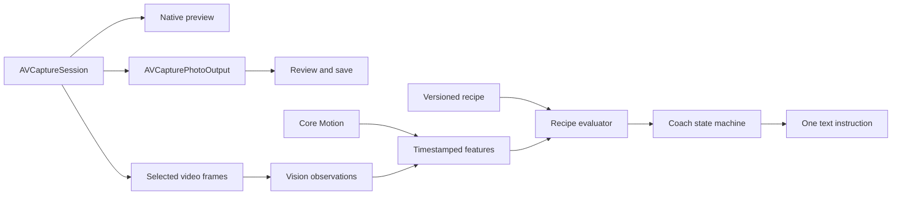

# Technical Requirements Document — Partner Photo Coach

Version: 0.2 · Date: October 11, 2026 · Status: Proposed architecture for audit
Prior versions: [versions/](versions/)
Companion: [PRD](PRD.md)

## 1. Authority and feasibility boundaries

The PRD governs behavior. This TRD specifies a proposed implementation, capability limits, and measurable verification. No implementation or performance benchmark exists yet. Device support, thresholds, and latency budgets remain provisional. A technical constraint that changes product behavior must update the PRD rather than silently reduce scope.

## 2. Proposed stack

Swift; SwiftUI for application UI; AVFoundation for capture and native preview; Vision for person/body landmark observations; Core Motion for phone attitude; SwiftUI sensory feedback for the readiness haptic; PhotoKit for user-directed saving. Use a UIView-backed AVCaptureVideoPreviewLayer rather than rendering each analyzed frame into SwiftUI. No game engine, server inference, conversational LLM, custom-trained model, or ARKit requirement in the prototype.

Minimum OS: iOS 18 (PRD D11). Minimum hardware is decided through benchmarking. Gate optional capture features by runtime availability and capability.

## 2a. Repository, accounts, and deployment

Single repository (monorepo):

| Path | Contents | When |
|---|---|---|
| `docs/` | Current PRD/TRD; dated snapshots in `docs/versions/` | Now |
| `ios/` | One plain Xcode project (SwiftUI app + Swift Testing target). No XcodeGen/Tuist or third-party dependencies until a need is shown. | Camera spike |
| `server/` | Cloud critique backend | Only when PRD D10 is scoped |

Development runs on a personal iPhone signed with a free Apple ID (Xcode personal team). Limits: provisioning expires after 7 days, no TestFlight, and no paid-only capabilities. Camera, Vision, Core Motion, and Photos all work. A paid Apple Developer Program membership is required before TestFlight, the couples pilot, or App Store submission.

Future deployment: the iOS app ships via Xcode archive → TestFlight → App Store (Xcode Cloud or GitHub Actions optional later). The backend, when built, is a small serverless API that holds the AI provider key (never shipped in the app), verifies StoreKit 2 subscription entitlements via the App Store Server API, and forwards consented photos for critique. Host and language are chosen at that point; a TypeScript serverless function is the expected default.

## 3. Architecture

The preview and photo capture never wait for inference or coaching. They share hardware resources, so independence of control flow does not guarantee resource isolation. Camera configuration runs on its own serial queue; analysis uses a separate bounded worker; UI state publishes on the main actor.

## 4. Camera pipeline

- Configure rear wide-angle 1× input, preview, photo output, and video data output using supported device formats.
- Request camera permission at first use. Request Photos add-only permission at save time; camera remains usable if saving is denied.
- Use AVCapturePhotoOutput for stills, not a low-resolution analysis frame.
- Enable responsive capture and zero-shutter-lag options only where supported and compatible with the chosen configuration; test memory and quality effects.
- Tap-to-focus/expose only where supported. Reset behavior must be explicit and testable.
- Prefer 30 fps preview baseline; evaluate 60 fps only after sustained performance testing. Proposed analysis input has a longest edge around 640 pixels, subject to accuracy tests and supported format constraints. A conversion/downsample step may be necessary and has a measurable cost.
- Handle authorization, session interruption, backgrounding, rotation restrictions, capture readiness, and errors. Stop inference while inactive. Reset observations on restart.
- Preserve the captured result until saving succeeds or the user discards it. Keep it independent of analysis-frame lifetimes.

## 5. Analysis scheduling

Start with 5 analyses/second as a tunable target. Maintain at most one in-flight analysis; discard new frames while occupied. Do not queue historical frames. Drop late video frames and observe drop callbacks. Reduce analysis frequency/resolution or disable costly checks under load; never let the worker block capture callbacks.

Every observation includes source frame timestamp, dimensions, orientation, crop transform, recipe version, subject selection, confidence, and completion time. Reject out-of-order, expired, wrong-recipe, or pre-interruption results. Proposed freshness cutoff: 500 ms, to be validated against the performance budget. Synchronize motion samples to frame time within a documented tolerance.

## 6. Coordinates and observations

Define canonical coordinates relative to the visible photo composition, not raw buffer layout. Explicitly transform Vision normalized coordinates through orientation, mirroring, and preview aspect-fill cropping. Keep sensor orientation, display orientation, and camera viewpoint distinct. Verify left/right and top/bottom on-device with asymmetric scenes.

Vision body landmarks do not necessarily provide exact head-top or shoe boundaries. Derive conservative bounds only when supported by observations; qualify padding assumptions. Missing landmarks mean unknown visibility, not proven cropping. Maintain identity continuity through short-term spatial association; if association becomes ambiguous, invalidate coaching. Prototype supports exactly one clearly detected subject; multiple people produce a one-time request to isolate the subject, rather than choosing silently.

Core Motion supplies device attitude. Map it to rear-camera optical orientation and portrait UI; validate sign and axis conventions. Roll can support a leveling check. Pitch does not by itself establish camera height or preferred portrait perspective.

## 7. Recipe contract

Bundle versioned JSON recipes, validated at load time:

| Field | Purpose |
|---|---|
| id, version, title, goal | Stable identity and intent |
| applicability | Orientation, lens, subject count, supported scene conditions |
| startingInstructions | Authored setup; clearly distinct from measured coaching |
| targets | Normalized ranges, not exact body proportions |
| checks | Feature requirements, confidence, priority, thresholds |
| actions | Approved instruction IDs and action semantics |
| temporalPolicy | Dwell, hysteresis, cooldown, expiry |
| provenance | Sources, authorship, asset rights status |

Each check returns pass/fail/unknown, confidence, severity, evidence, and a candidate action. Unknown never becomes fail by default. Rule output is deterministic given the same inputs and recipe. The app uses approved text templates; no generated free-form advice in the first pass.

## 8. Coach state machine

States: starting → observing → adjusting or ready; uncertain and paused may interrupt; camera interruption invalidates state. Re-enter observing after recovery. Use distinct enter/exit thresholds and sustained evidence.

Proposed defaults: 300–500 ms evidence dwell; minimum 1.5 seconds instruction visibility unless evidence becomes invalid; 1 second readiness dwell; skip cooldown 10 seconds for that check, or until a meaningful scene/recipe change. These values need user testing. Suppress display immediately when advice becomes unsafe/stale; do not preserve an invalid instruction merely to satisfy dwell. Only switch to another valid instruction after policy checks. Confidence loss replaces advice with neutral observing/uncertain state.

An action such as “step back” changes perspective and must be recipe-approved; an action such as “aim left” changes composition. Do not infer physical camera movement from a two-dimensional position error alone. Do not claim improved facial attractiveness. “Ready” reflects only supported checks.

## 9. Performance budgets — proposed acceptance targets

| Metric | Target | Measurement |
|---|---|---|
| Preview | Sustained 30 fps baseline; coaching adds no visible recurring stutter | Frame/drop instrumentation plus external high-frame-rate recording for displayed behavior |
| Analysis freshness | p95 frame-to-feature completion ≤250 ms | Monotonic timestamps over a sustained run |
| Corrective response | p95 ≤1 second from stable detectable error to instruction | Controlled scene changes, including dwell |
| Shutter UI acknowledgment | p95 ≤100 ms | Input-to-feedback signposts; distinct from exposure latency |
| Capture overhead | Coaching adds ≤100 ms p95 exposure delay relative to identical app configuration with coaching off | Controlled moving timer/test rig; compare coaching on/off |
| Startup overhead | Coaching adds ≤200 ms p95 to usable preview versus coaching off | Repeated cold/warm launches |
| Sustained session | 10 minutes without serious/critical thermal state or accumulating queue/memory growth under specified indoor conditions | Instruments, thermal state, frame rate, and memory tracking |

These gates do not assert native Camera parity. Separately compare Apple's Camera app on the same phone, scene, lens, and approximate capture settings, documenting settings that cannot be matched. Capture quality and computational photography parity are not guaranteed.

Benchmark at least the proposed oldest supported iPhone and one recent device. Record OS, ambient temperature, lighting, charging state, configuration, and sample sizes. Choose support boundaries only after results.

## 10. Degradation and failures

Under thermal/load pressure: reduce analysis cadence, then expensive checks, then pause coaching with a concise status. Keep capture functioning where the OS permits. With low confidence or low light, do not invent corrective guidance. Missing motion disables orientation checks. Save denial/error keeps review available and offers retry/settings as appropriate. Session interruptions clear advice and restore observing only after valid new samples. Capture readiness is independent of coaching readiness.

## 11. Data and diagnostics

No uploads, identity templates, or persistent analysis frames. Recipes and preferences are local. Photos remain local and save only on user action. Optional diagnostic logs contain timings, rule IDs, confidence, and failure states; no images or facial coordinates by default. Any opt-in research captures have explicit purpose, retention, and deletion controls. Validate privacy declarations against actual SDK/data usage before distribution.

## 12. Verification

- Unit tests for recipe validation, pass/fail/unknown, instruction priority, hysteresis, cooldown, stale-result rejection, and coordinate transforms.
- Annotated consented/original fixtures for landmark variability and supported check correctness; include partial bodies, occlusion, different clothing/body proportions, low light, and multiple subjects.
- Integration tests for permission denial, capture during analysis, interruption/resumption, saving failure, and recipe changes mid-analysis.
- Physical-device tests for orientation/action direction, photo versus preview composition, capture quality, performance, and sustained thermal behavior.
- Couple pilot defined in PRD; distinguish measurement accuracy, instruction correctness, and photo preference.

## 13. Delivery sequence

1. Camera spike: preview, capture, review/save; establish coaching-off baseline.
2. Capability spike: landmarks, motion, coordinates, and one reliable correction; identify unsupported claims.
3. Coach loop: recipe evaluator, temporal policy, skip/pause, readiness, uncertainty.
4. Expand to three or four validated corrections within one recipe.
5. Performance and usability pilot; update scope, thresholds, and support matrix.
6. Audit PRD/TRD revisions before adding recipes, pose coaching, or advanced perspective guidance.

## 14. Technical sources

- [AVCaptureVideoDataOutput](https://developer.apple.com/documentation/avfoundation/avcapturevideodataoutput): camera-frame delivery.
- [Live Vision camera example](https://developer.apple.com/documentation/vision/recognizing-objects-in-live-capture): bounded analysis and skipping frames.
- [Handling frame drops](https://developer.apple.com/library/archive/technotes/tn2445/_index.html): capture throughput and drop handling.
- [Body pose detection](https://developer.apple.com/documentation/vision/detecting-human-body-poses-in-images): landmarks and confidence.
- [CMDeviceMotion](https://developer.apple.com/documentation/coremotion/cmdevicemotion): device attitude.
- [AVCapturePhotoOutput](https://developer.apple.com/documentation/avfoundation/avcapturephotooutput): still capture and capability-dependent responsiveness.

These sources establish platform capabilities; project latency targets, decision rules, and product effectiveness are proposals requiring measurement.

## 15. Decision log

| Date | Change | Status |
|---|---|---|
| October 11, 2026 | Proposed native local pipeline, one recipe, bounded inference, and validation gates | v0.1 draft; audit and feasibility spike pending |
| October 11, 2026 | iOS 18 baseline, readiness haptic, repo layout, free-account local development, future deployment and backend outline | v0.2; v0.1 in versions/ |
